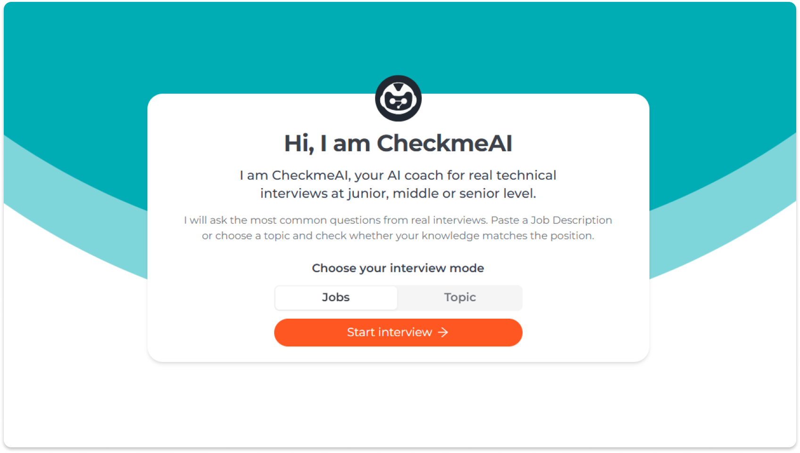
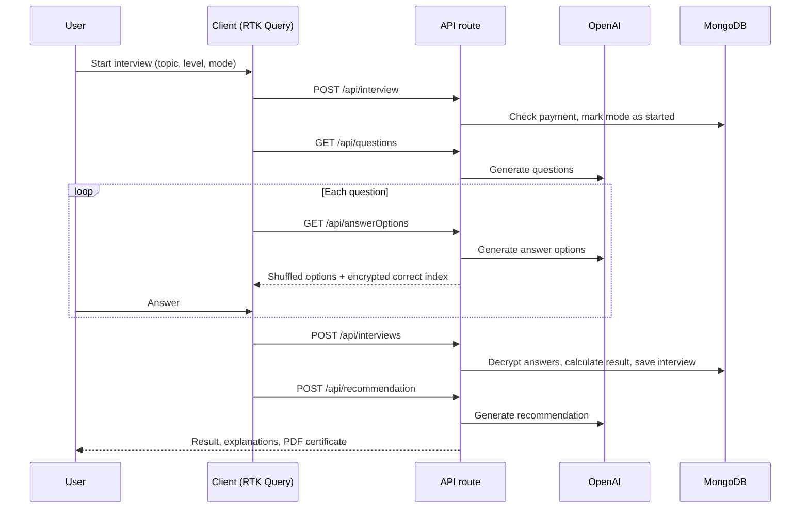

# CheckmeAI Demo

AI interview trainer: pick a technology and level, answer generated questions and get a scored result with explanations.

[](https://github.com/MarkupChef/CheckmeAI-demo/actions/workflows/ci.yml)
[](LICENSE)

**Live demo:** https://checkmeai-demo.vercel.app



> Demo runs on test credentials: Stripe test mode (card `4242 4242 4242 4242`, any future date and CVC) and a separate demo database. One paid interview per user.

## About

CheckmeAI helps you prepare for a technical interview by topic or by a job description, find gaps in your knowledge and get an instant explanation for any question. It was launched as a commercial product with paying users; this repository is its demo version.

- **Interview by topic:** almost 150 topics at junior, middle and senior levels.
- **Interview by job description:** paste a vacancy text and get questions that match its requirements.
- **AI-generated content:** questions, answer options, explanations and recommendations are generated by OpenAI.
- **Instant explanations:** an AI explanation of the correct answer for any question.
- **Knowledge gaps:** AI analyzes wrong answers, groups them by topic and recommends what to study next.
- **PDF certificate:** issued after a topic is passed successfully in Interview mode.
- **Public results:** an interview result can be shared by a public link.
- **Payments:** paid interview modes with Stripe.

**Stack:** Next.js 15 (App Router) · React 19 · TypeScript · Redux Toolkit / RTK Query · Ant Design · Tailwind CSS · SCSS modules · MongoDB / Mongoose · NextAuth (Google, GitHub) · OpenAI API · Stripe · Google Sheets API · @react-pdf

## Scripts

| Command             | Description            |
| ------------------- | ---------------------- |
| `npm run dev`       | Dev server (Turbopack) |
| `npm run build`     | Production build       |
| `npm start`         | Start production build |
| `npm run lint`      | ESLint                 |
| `npm run typecheck` | TypeScript check       |

CI runs lint and typecheck on every push and pull request to `main`. The build runs on Vercel, because prerendering needs database and Google Sheets access.

## Key decisions

- **Structured AI output.** OpenAI responses are parsed with `zodResponseFormat`, so questions, options and explanations always come back in a typed shape.
- **Encrypted correct answers.** The index of the correct option is encrypted with a date-based key before it is sent to the client. The server decrypts it when the interview is saved and calculates the result.
- **Content from Google Sheets.** Topics and levels are edited in a spreadsheet without deploys. Pages are statically generated with ISR (`revalidate = 86400`).
- **Thin route handlers.** `src/app/api/**/route.ts` checks the session and calls a controller. Business logic lives in `src/server/controllers`, AI calls in `src/server/ai_methods`, prompts in `src/server/prompts`.
- **Rate limiting.** The job-description check is protected by an in-memory rate limiter.
- **Demo mode.** `NEXT_PUBLIC_DEMO_MODE` shows the test card hint and limits paid interviews to one per user.

## How an interview works



## Project structure

```
src/
  app/          routes (server components) and API route handlers
  components/   UI components, page-level client components in pages/
  server/       controllers, AI methods, prompts, Mongoose models
  store/        Redux slices and RTK Query APIs
  i18n/         i18next setup (translations in public/locales)
```

## Limitations

- English only.
- No automated tests yet.
- UI is being migrated from Flowbite to Ant Design, some components are still on Flowbite.
- Repeated builds within a minute can hit the Google Sheets API quota.

## License

[MIT](LICENSE)
